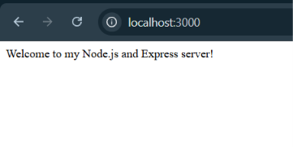
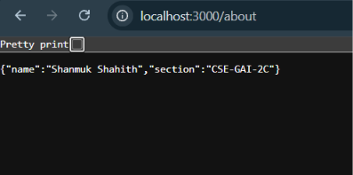
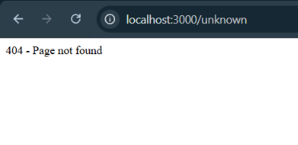

# Lab 1: Node.js and Express Server

**Subject:** Backend Development Fundamentals  
**Year/Term:** Year II, Term II  
**University:** Aurora Deemed to be University  
**Faculty:** Mr. Joel Prashanth D

## Student Details

| Field               | Details           |
| ------------------- | ----------------- |
| Name                | Shanmuk Shahith   |
| Registration Number | 252U1R9137        |
| Section             | CSE - GEN-AI - 2C |

## Live Deployment

**Deployment Link:** [Open Live Application](https://backend-development-fundamentals-lab-1.onrender.com/)

The application is deployed on Render and can be accessed through the public URL above.

## Project Objective

This lab demonstrates the fundamentals of creating and running a Node.js backend server using the built-in HTTP module and Express.js. It covers project initialization with npm, dependency installation, server setup, route handling, JSON responses, date and time generation, HTTP status codes, and handling unknown routes.

## Technologies Used

- Node.js
- Express.js
- npm (Node Package Manager)
- JavaScript (CommonJS)
- HTTP and JSON response handling
- Render (Deployment Platform)
- GitHub (Version Control and Repository Hosting)

## Project Folder Structure

```text
lab-01/
├── app.js
├── server.js
├── package.json
├── package-lock.json
├── README.md
├── .gitignore
└── screenshots/
    ├── home.png
    ├── about.png
    ├── time.png
    └── not-found.png
```

## Installation and Execution

### Prerequisites

- Node.js and npm installed on the computer.
- Visual Studio Code or another code editor.
- Git, if using Git for version control.

### 1. Initialize the Project

If starting from an empty project directory, run:

```bash
npm init -y
```

### 2. Install Express.js

Run the following command in the project directory:

```bash
npm install express
```

### 3. Run the Basic Node.js HTTP Server

```bash
node server.js
```

Open the following URL in your browser:

`http://localhost:3000`

The server responds with `Hello`.

Stop the server using `Ctrl + C` before starting the Express server.

### 4. Run the Express Server

```bash
node app.js
```

The Express application listens on port 3000 locally and uses the port configured by the hosting platform when deployed.

## Endpoints

| HTTP Method | Path             | Description                                           | Expected Status Code |
| ----------- | ---------------- | ----------------------------------------------------- | -------------------: |
| GET         | `/`              | Returns a welcome message                             |                  200 |
| GET         | `/about`         | Returns the student's name and section in JSON format |                  200 |
| GET         | `/time`          | Returns the current date and time using `new Date()`  |                  200 |
| Any         | Any unknown path | Returns a Page Not Found message                      |                  404 |

### Live Endpoint URLs

- **Home:** [Open Home Route](https://backend-development-fundamentals-lab-1.onrender.com/)
- **About:** [Open About Route](https://backend-development-fundamentals-lab-1.onrender.com/about)
- **Time:** [Open Time Route](https://backend-development-fundamentals-lab-1.onrender.com/time)
- **404 Test:** [Test Unknown Route](https://backend-development-fundamentals-lab-1.onrender.com/unknown)
## Screenshots

Screenshots of the working application are stored in the `screenshots/` directory.

### 1. Home Route



### 2. About Route



### 3. Time Route


### 4. Unknown Route — 404 Not Found




## Problems Faced and Solutions

| Problem                                   | Solution                                                                |
| ----------------------------------------- | ----------------------------------------------------------------------- |
| Initializing a Node.js project            | Used `npm init -y` to create `package.json`.                            |
| Express was not available by default      | Installed Express.js using `npm install express`.                       |
| Returning different response formats      | Used `res.send()` for text and `res.json()` for JSON responses.         |
| Handling unknown routes                   | Added a final Express middleware that returns HTTP status code 404.     |
| Running multiple servers on the same port | Stopped the running server before starting another server on port 3000. |

## Learning Outcomes

- Created and initialized a Node.js project using npm.
- Understood the purpose of `package.json`, `package-lock.json`, and `node_modules/`.
- Created a basic HTTP server using Node.js.
- Installed and used Express.js to build a backend server.
- Implemented GET routes using `app.get()`.
- Returned text and JSON responses.
- Generated the current date and time using `new Date()`.
- Handled unknown routes using HTTP status code 404.
- Tested endpoints and prepared project documentation for GitHub submission.
- Deployed a Node.js and Express application using Render.

## Git Hygiene

The following entries should be included in the `.gitignore` file:

```gitignore
node_modules/
.env
```

Do not commit the `node_modules/` directory, environment files, API keys, passwords, or other sensitive credentials to GitHub.
