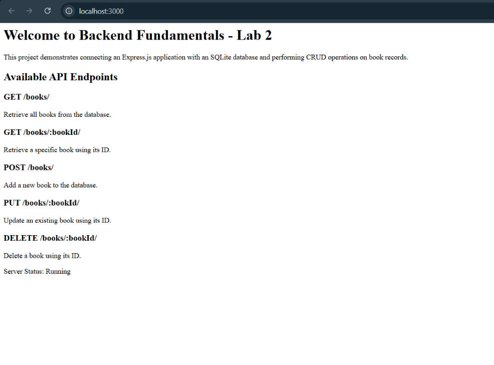
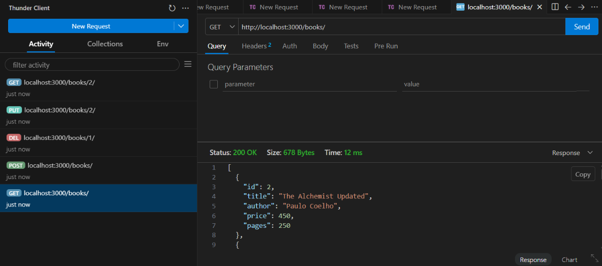
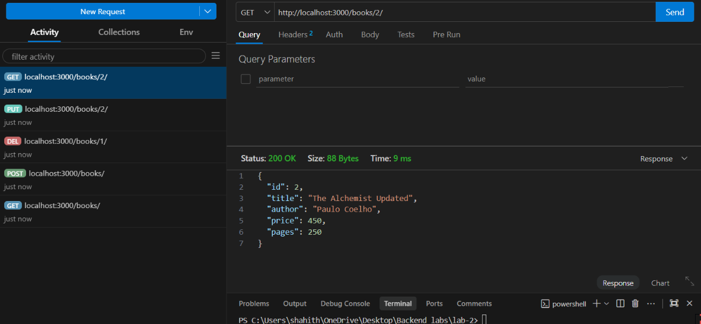
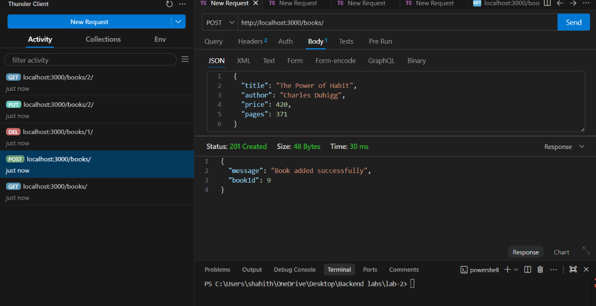
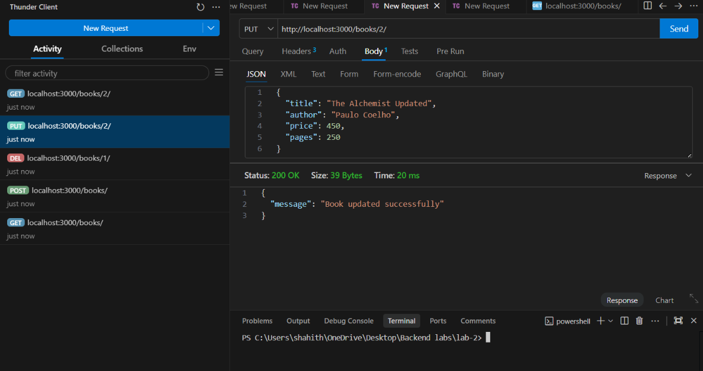
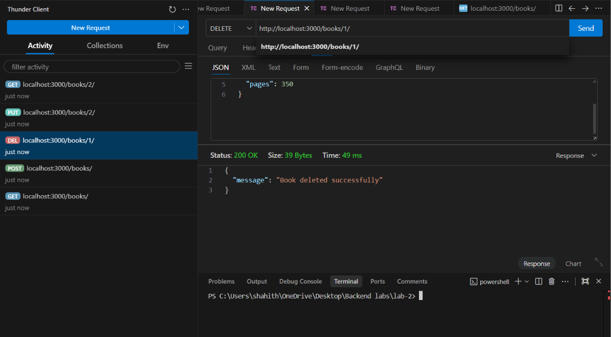

# Lab 2: SQLite Database and CRUD Routes

## Subject Details

| Field       | Details                          |
| ----------- | -------------------------------- |
| Subject     | Backend Development Fundamentals |
| Year / Term | Year II, Term II                 |
| University  | Aurora Deemed to be University   |
| Faculty     | Mr. Joel Prashanth D             |

## Student Details

| Field               | Details           |
| ------------------- | ----------------- |
| Name                | Shanmuk Shahith   |
| Registration Number | 252U1R9137        |
| Section             | CSE - GEN-AI - 2C |

# Live Deployment

Deployed Application: https://backend-lab-2-r9dc.onrender.com/

The application is deployed using Render. You can access the home page and test the available API endpoints using the deployed URL.
## Project Objective

The objective of this lab is to connect an Express.js application with an SQLite database and implement CRUD (Create, Read, Update, Delete) operations through HTTP API endpoints.

The application manages book records stored in an SQLite database. It demonstrates database connectivity, SQL queries, asynchronous operations using async/await, parameterized queries, and REST API development.

## Technologies Used

- Node.js
- Express.js
- SQLite
- SQLite3
- JavaScript (CommonJS)
- Thunder Client
- npm (Node Package Manager)
- Git and GitHub

## Project Folder Structure

```text
lab-02/
├── README.md
├── app.js
├── database.js
├── books.db
├── package.json
├── package-lock.json
├── .gitignore
└── Screenshots/
    ├── home.png
    ├── get-all-books.png
    ├── get-book-by-id.png
    ├── post-book.png
    ├── put-book.png
    ├── delete-book.png
    └── not-found.png
```

## Database Structure

Database Name: `books.db`

Table Name: `book`

| Column | Data Type                         | Description            |
| ------ | --------------------------------- | ---------------------- |
| id     | INTEGER PRIMARY KEY AUTOINCREMENT | Unique book identifier |
| title  | TEXT                              | Book title             |
| author | TEXT                              | Author name            |
| price  | INTEGER                           | Book price             |
| pages  | INTEGER                           | Number of pages        |

The database contains sample book records used to test the CRUD operations.

## Installation and Execution

### Prerequisites

- Node.js and npm installed.
- Visual Studio Code or another code editor.
- Git installed.
- Thunder Client extension installed in VS Code.

### 1. Install Dependencies

Navigate to the project directory and run:

```bash
npm install
```

### 2. Start the Application

Run:

```bash
node app.js
```

The server runs at:

`http://localhost:3000/`

### 3. Database Connection

The application connects to the SQLite database using the `sqlite` and `sqlite3` packages.

The database connection is established before the Express server starts.

## API Endpoints

| HTTP Method | Endpoint          | Description                           |
| ----------- | ----------------- | ------------------------------------- |
| GET         | `/books/`         | Retrieve all books                    |
| GET         | `/books/:bookId/` | Retrieve a specific book using its ID |
| POST        | `/books/`         | Add a new book                        |
| PUT         | `/books/:bookId/` | Update an existing book               |
| DELETE      | `/books/:bookId/` | Delete a book using its ID            |

### 1. GET All Books

**Endpoint:** `GET /books/`

Retrieves all book records stored in the database.

### 2. GET Book by ID

**Endpoint:** `GET /books/:bookId/`

Retrieves a specific book using its unique ID.

### 3. POST a New Book

**Endpoint:** `POST /books/`

Adds a new book to the database.

Example JSON request body:

```json
{
  "title": "The Power of Habit",
  "author": "Charles Duhigg",
  "price": 420,
  "pages": 371
}
```

### 4. PUT Update Book

**Endpoint:** `PUT /books/:bookId/`

Updates the details of an existing book using its ID.

Example JSON request body:

```json
{
  "title": "Atomic Habits Updated",
  "author": "James Clear",
  "price": 500,
  "pages": 350
}
```

### 5. DELETE Book

**Endpoint:** `DELETE /books/:bookId/`

Deletes a specific book from the database using its ID.

## Screenshots

The following screenshots demonstrate the working application and API testing performed using Thunder Client.

### 1. Application Home Page



### 2. GET All Books



### 3. GET Book by ID



### 4. POST a New Book



### 5. PUT Update Book



### 6. DELETE Book



## Important Concepts Learned

- Connecting an Express.js application to an SQLite database.
- Creating database tables using SQL.
- Performing CRUD operations through HTTP methods.
- Using `async` and `await` for asynchronous database operations.
- Retrieving records using `db.all()` and `db.get()`.
- Inserting, updating, and deleting records using `db.run()`.
- Using parameterized SQL queries with `?` placeholders.
- Accessing URL parameters through `request.params`.
- Accessing JSON request data through `request.body`.
- Testing REST API endpoints using Thunder Client.
- Handling HTTP status codes and errors.

## Git Hygiene

The following entries should be included in `.gitignore`:

```gitignore
node_modules/
.env
```

Do not commit `node_modules/`, environment files, API keys, passwords, or other sensitive credentials.

## Conclusion

This lab provided practical experience in integrating SQLite with an Express.js backend application. It helped develop an understanding of relational database operations and implementing REST APIs to create, retrieve, update, and delete book records.
